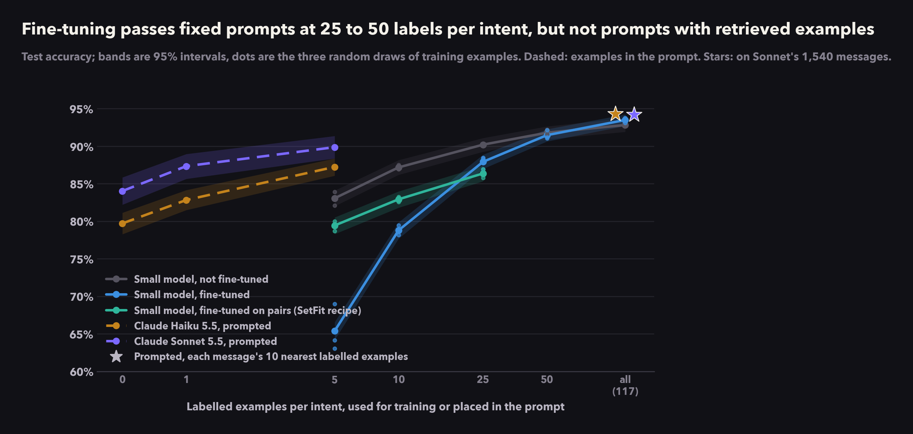

# Fine-tune or prompt?

**When does fine-tuning a small model pay off, compared with prompting a large hosted model?** On 77-intent banking support messages, rarely. With few labels, prompt. With many, put each message's most similar labelled examples in the prompt: that beat fine-tuning on accuracy, for 6 cents per 1,000 requests.

[](https://github.com/ai-with-md/finetune-or-prompt/actions/workflows/tests.yml)




**New here?** Read the one-page [decision memo](docs/decision_memo.md) for the answer a team would act on, then [notebook 02](notebooks/02_finetune_vs_prompt.ipynb) for the result that changed the conclusion.

## What we found

| Common belief | What happened on Banking77 | Notebook |
|---|---|---|
| Fine-tuning beats prompting when labels are scarce | Given the same 385 labelled examples, Claude Haiku with them in its prompt got **86.7%** right; a model fine-tuned on them got **62.4%** | [02](notebooks/02_finetune_vs_prompt.ipynb) |
| With plenty of labels, fine-tune | Haiku given each message's 10 most similar labelled examples got **94.3%**, ahead of the fine-tuned model's 93.3%, for **6 cents** per 1,000 requests | [02](notebooks/02_finetune_vs_prompt.ipynb) |
| A fine-tuned model is simply more accurate than a prompt | Most of its lead over fixed prompts was **learned labelling habit**: counting answers as defensible as the label, Sonnet came out 0.9 points ahead | [02](notebooks/02_finetune_vs_prompt.ipynb) |
| Fine-tuning is what makes a small model good | A small model that was **not fine-tuned**, trained in about a second, came within a point; a recipe built for few labels (SetFit) trailed it by **4 points** | [03](notebooks/03_learning_curve.ipynb) |
| Prompting a large model is too expensive at scale | Prompt caching cut the bill by **85 to 94%**; Haiku with examples stayed cheaper than a model of your own up to about **7 million** requests a month | [04](notebooks/04_cost_and_speed.ipynb), [05](notebooks/05_break_even.ipynb) |
| Self-hosting cost is mostly the server | The server was about **\$53** of a fixed cost near **\$870** a month; engineer time and labels were the rest | [05](notebooks/05_break_even.ipynb) |
| Price per request decides | What a **wrong answer costs** moved the answer most: at one cent a mistake, a model of your own paid off from about 1 million requests a month instead of 7 million | [05](notebooks/05_break_even.ipynb) |

Every number is measured on the same test messages, with 95% intervals in the notebooks. The whole study cost \$5.93 in API calls.

## The question

A team needs to sort customer messages into 77 banking intents. They can:

1. **Prompt a large hosted model** (Claude Haiku 5.5 or Sonnet 5.5). No training, pay per request.
2. **Fine-tune a small open model** (ModernBERT-base, 150M parameters) on labelled examples and serve it themselves. Pay once for labels and training, then a fixed amount for a server.
3. **Use a small model without fine-tuning** (frozen bge-small embeddings plus a linear classifier), the cheapest option of all.
4. **Combine them**: the small model finds the labelled examples most similar to each message, and the hosted model reads them and chooses.

This study measures all of them on the same test messages and turns the results into a decision: how many requests a month, how many labelled examples and what price per wrong answer make each option worth it.

## Notebooks

| # | Question | Short answer |
|---|---|---|
| [01](notebooks/01_task_and_baseline.ipynb) | What does the task look like, and how far does a model with no fine-tuning get? | Short messages, 77 intents; 83% right with 5 labels per intent, 93% with all |
| [02](notebooks/02_finetune_vs_prompt.ipynb) | Does a fine-tuned small model beat a prompted large one on the same messages? | Only prompts with fixed examples; with each message's nearest labelled examples, Haiku beats it |
| [03](notebooks/03_learning_curve.ipynb) | How many labelled examples does fine-tuning need to catch up? | 25 to 50 per intent to pass fixed prompts; it never clearly beats not fine-tuning |
| [04](notebooks/04_cost_and_speed.ipynb) | What does each option cost per 1,000 requests, and how fast is it? | Haiku 3 to 11 cents, Sonnet 43 cents to \$1.27; local models answer in 5 to 15 ms, hosted in about a second |
| [05](notebooks/05_break_even.ipynb) | At what monthly volume does fine-tuning pay off, and when does the answer flip? | Prompting is cheapest up to about 0.1 to 5 million requests a month, depending most on what a mistake costs; above that, the combined option |

The findings, and when to choose which option, are summarised in a one-page [decision memo](docs/decision_memo.md).

## How the study is run

- **Same test messages for every approach**, so differences are measured in pairs, with 95% intervals from resampling the test set. Where Sonnet answered only 20 messages per intent (1,540, to save cost), every comparison uses those.
- **No tuning on the test set.** A validation set is held out from training, and each approach picks one setting on it that is then used at every training size. Tuning per size would flatter the small sizes.
- **Training sizes are nested** (the 10 examples per intent include the 5), with three random draws each, so the learning curve shows the value of more labels rather than the luck of a draw.
- **Prompts and small models see the same labels.** The five examples per intent in a prompt are the same 385 messages the small models trained on at that size.
- **Every paid request is on file.** Each hosted answer is saved with its token counts and timing, so costs and speeds are computed from what was actually used. Prompts are cached, and a hard cap stops spending.
- **Errors are read, not just counted.** The messages every option misses, and every disagreement between the fine-tuned model and Sonnet, were read by hand to separate model mistakes from label problems.
- **Assumptions are stated and varied.** Engineer time, label price and the cost of a mistake are not measured, so notebook 05 shows how far each one moves the answer.
- **Models run locally** in a separate environment ([requirements-train.txt](requirements-train.txt)) and save only their test predictions to [results/](results/). The notebooks read those files, so they rerun without model weights or an API key.

## Data

[Banking77](https://huggingface.co/datasets/PolyAI/banking77) (Casanueva et al., 2020), published by PolyAI under CC BY 4.0: 10,003 training and 3,080 test messages, 77 intents. The data is downloaded by a script at a pinned revision and checked against SHA-256 checksums; it is not stored in this repo.

## Run it

```bash
python -m venv .venv && source .venv/bin/activate
pip install -e ".[dev]"
python scripts/download_data.py
pytest -q
```

To rerun the models themselves (Python 3.12; saved predictions are already in `results/`):

```bash
python3.12 -m venv .venv-train
.venv-train/bin/pip install -r requirements-train.txt -e .
.venv-train/bin/python scripts/frozen_baseline.py   # about a minute on an Apple M4
.venv-train/bin/python scripts/finetune.py          # about 2.5 hours on an Apple M4 GPU; resumes if stopped
.venv-train/bin/python scripts/contrastive_finetune.py   # the SetFit recipe at small sizes, about an hour
```

The hosted models need an Anthropic API key in a `.env` file in the repo root (`ANTHROPIC_API_KEY=...`; the file is ignored by git). Every answer is saved as it arrives, so a stopped run resumes without paying twice, and spending stops before a $15 cap:

```bash
.venv-train/bin/python scripts/run_api.py --dry-run   # the plan and its cost, no paid calls
.venv-train/bin/python scripts/run_api.py --pilot     # 50 messages, checks the prompt cache works
.venv-train/bin/python scripts/run_api.py             # all six runs, about $3
.venv-train/bin/python scripts/run_api.py --retrieved # two runs with each message's 10 nearest labelled examples, about $1.70
```

## License

Code: MIT. Banking77: CC BY 4.0, by PolyAI.
